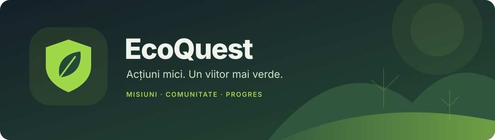

<div align="center">



**Transformă obiceiurile bune în misiuni. Crește un copac. Construiește o comunitate.**


[Experiența](#experiența-ecoquest) · [Pornire rapidă](#pornire-rapidă) · [Arhitectură](#arhitectură) · [Documentație API](server/README.md)

</div>

## Despre proiect

**EcoQuest** este o aplicație Android care transformă acțiunile pentru mediu într-o aventură zilnică. Mersul pe jos, returnarea ambalajelor SGR, reducerea risipei și susținerea producătorilor locali devin misiuni cu obiective clare, progres vizibil și recompense.

Experiența combină personalizarea, un copac care crește odată cu activitatea ta și competiția cu prietenii sau comunitatea. Interfața este disponibilă în română și engleză, cu teme deschisă și întunecată, plus culorile dinamice ale telefonului prin Monet pe Android 12+.

## Experiența EcoQuest

| | Ce poți face |
|---|---|
| 🎯 **Misiuni pentru tine** | Primești șase misiuni zilnice selectate după răspunsurile inițiale, localitate și accesul la transport. Selecția rămâne stabilă pe durata zilei. |
| 🚶 **Mișcare cu sens** | Înregistrezi trasee pe jos sau cu bicicleta. Progresul este păstrat când închizi ecranul misiunii, iar înregistrarea activă continuă prin serviciul GPS. |
| ♻️ **Bonuri SGR** | Fotografiezi bonul în aplicație sau îl alegi din galerie. Serverul citește data și ora și împiedică reutilizarea bonurilor acceptate. |
| 🌳 **Grădina personală** | Crești un copac prin șapte etape și concurezi în clasamentul după înălțime. |
| 🤝 **Prieteni și echipe** | Adaugi prieteni prin cod, accepți invitații și contribui la obiective comune. |
| ⚔️ **Dueluri 1v1** | Provoci un prieten la un amical sau intri într-un meci clasat cu un adversar aleatoriu, timp de șapte zile. |
| 🏆 **Progres și recompense** | Aduni EcoPoints și EcoCoins, avansezi în opt ligi și deblochezi badge-uri. |
| 💬 **Eco AI și trivia** | Primești explicații despre aplicație și impactul tău, descoperi informații eco și participi la quiz-ul zilnic. |

### Un copac care crește cu tine

Finalizează cel puțin o misiune într-o zi pentru a îngriji copacul. Mai multe misiuni în aceeași zi acordă o singură zi de creștere.

- **Șapte etape**, de la sămânță până la maturitate; avansezi la fiecare trei zile consecutive de activitate.
- **Înainte de maturitate**, prima zi ratată îl ofilește, iar fiecare pereche de zile ratate consecutiv îl coboară o etapă.
- **După maturitate**, câștigă un metru pe zi activă și pierde un metru pe zi ratată, rămânând matur, cu minimum un metru înălțime.
- **Peste 20 m**, grădina afișează doar vârful și înălțimea totală.

Evoluția și clasamentul sunt calculate pe server. Zilele se schimbă la miezul nopții, ora României.

### Competiție prietenoasă sau clasată

Duelurile numără **EP câștigate în cele șapte zile ale meciului**, inclusiv din trivia. Punctele inițiale din chestionar nu intră în scor.

Amicalele cu prietenii rămân separate de statisticile clasate. În meciurile cu adversari aleatorii primești **3 puncte pentru victorie** sau **1 punct pentru egalitate**, afișate pe profil separat de EcoPoints.

## Pornire rapidă

### Cerințe

- **Android Studio**, Android SDK 35 și **JDK 17+** pentru aplicație; dispozitiv cu Android 8.0 sau mai nou.
- **Node.js 24**, npm și **Python 3.12** recomandat pentru backend și OCR.
- Pe Linux, OpenCV poate necesita `libgl1` și `libglib2.0-0`; scripturile de deploy le instalează.

### 1. Pornește backendul

Din rădăcina proiectului:

```bash
cd server
npm ci
python3 -m venv .venv-ocr
.venv-ocr/bin/python -m pip install -r requirements-ocr.txt
cp .env.example .env
```

Editează `.env` și setează un **`JWT_SECRET` aleator, de minimum 32 de caractere**. Poți genera unul cu `openssl rand -hex 32`. Apoi:

```bash
npm run dev
```

Verifică serviciul la `http://127.0.0.1:5200/api/health`. Baza SQLite și tabelele sunt create automat la pornire.

### 2. Configurează aplicația

Deschide rădăcina proiectului în Android Studio și adaugă în fișierul local `local.properties`, alături de configurația SDK:

```properties
GG_API_URL=https://api.example.ro
```

Înlocuiește adresa cu backendul tău, apoi folosește **Sync → Run**. URL-ul nu trebuie să includă sufixul `/api`.

Pentru un backend local accesat din emulatorul Android:

```properties
GG_API_URL=http://10.0.2.2:5200
```

În acest caz setează `HOST=0.0.0.0` în `.env`. Excepția HTTP a aplicației este limitată la `10.0.2.2`; pentru un telefon fizic folosește un endpoint HTTPS accesibil dispozitivului.

### 3. Integrări opționale

| Integrare | Configurare |
|---|---|
| **Eco AI** | Gateway Kilo, configurat în `.env`. Aplicația oferă și răspunsuri locale de rezervă când serviciul nu este disponibil. |
| **Transport public** | `TRANZY_API_KEY` în backend pentru verificarea vehiculelor CTP Iași. Validarea transportului este disponibilă în zona suportată din Iași. |
| **Culori Monet** | Se activează din **Profil → Culorile telefonului**. Verdele EcoQuest este implicit. |

Valorile private rămân în `.env` și `local.properties`, fișiere excluse din Git. Cheile serviciilor externe sunt configurate pe server.

## Arhitectură

```text
Android · Kotlin / Compose
         │
         │ API REST + streaming SSE pentru AI
         ▼
Backend · Node.js / Express
         ├── SQLite: conturi, misiuni, progres, prieteni, dueluri, copaci
         ├── RapidOCR / ONNX: citirea locală a bonurilor
         ├── Kilo: conversații Eco AI
         └── Tranzy: vehicule de transport public în timp real
```

**Serverul decide recompensele și progresul.** Aplicația colectează dovezile și afișează rezultatul, iar catalogul de pe server stabilește EP, EcoCoins și impactul asociat misiunilor.

| Director | Conținut |
|---|---|
| [`app/`](app/) | Aplicația Android, interfața Compose, localizare RO/EN, cameră și GPS. |
| [`server/src/`](server/src/) | API, persistență, validare, personalizare, social, dueluri, copac și AI. |
| [`server/test/`](server/test/) | Teste pentru API, recompense, OCR, trasee, personalizare și competiție. |
| [`server/deploy/`](server/deploy/) | Instalare pe server, serviciu systemd și configurații de deploy. |

Identificatorul Android și unele căi tehnice păstrează denumirea istorică pentru compatibilitatea instalărilor și a datelor; numele produsului este **EcoQuest**.

## Date și verificare

- **Bonurile SGR** sunt procesate de OCR pe server, în fișiere temporare șterse după procesare. Citirea OCR nu folosește un API cloud.
- **Alte fotografii și documente** folosesc procesare pe telefon pentru etichete sau text, în funcție de misiune.
- **Conversația AI** rămâne disponibilă la schimbarea meniurilor pe durata sesiunii. Pentru răspunsurile online, mesajele și contextul de impact sunt trimise gatewayului AI.
- **Impactul ecologic** este o estimare educațională bazată pe regulile aplicației. Reprezentările cu urși polari sau cuburi sunt echivalențe vizuale; suprafața de gheață nu reprezintă o măsurare a volumului real.

Detaliile despre dovezi, limite, configurare și endpointuri sunt în [documentația backendului](server/README.md).

## Verificarea proiectului

Testele backend:

```bash
cd server
npm test
```

Testul OCR cu o fotografie reală se activează separat prin `GG_RECEIPT_TEST_IMAGE`; fotografia nu este inclusă în repository. Instrucțiunile sunt în [ghidul OCR](server/README.md#server-receipt-ocr-setup).

Pentru Android, folosește configurația **app** din Android Studio. Dacă ai **Gradle 8.9** instalat și configurat cu JDK-ul potrivit, poți construi și din rădăcina proiectului:

```bash
gradle :app:assembleDebug
```

## Deploy

Sunt disponibile două variante documentate:

- [Cloudflare + systemd](server/deploy/CLOUDFLARE.md)
- [nginx + Let's Encrypt](server/README.md#alternative-deploy-nginx--lets-encrypt-on-the-server)

La actualizări care schimbă contractul API, publică împreună backendul și aplicația Android. Configurația privată și baza de date se păstrează separat de cod.

## Licență

EcoQuest este licențiat sub **GNU General Public License v3.0 (GPL-3.0-only)**. Textul complet este disponibil în [LICENSE](LICENSE). Dependențele terțe își păstrează propriile licențe.

---

<div align="center">

**EcoQuest — fiecare acțiune bună merită să crească.**

</div>
